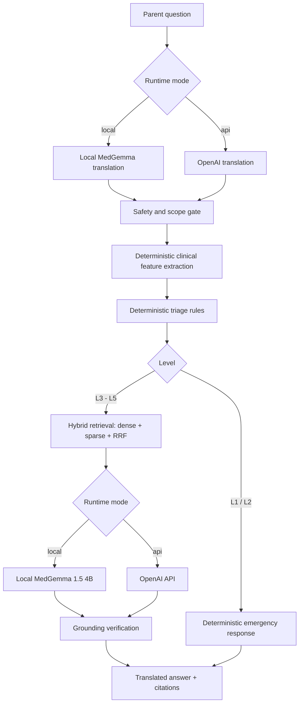

# MediMama 🍼

**Safety-oriented pediatric triage prototype with grounded RAG.**

A multilingual research prototype with one codebase and two selectable inference modes:

- **Mode 1 — Local model:** Google **MedGemma 1.5 4B** runs locally through Hugging Face Transformers. This is the mode to demonstrate local-model integration in a GitHub portfolio.
- **Mode 2 — API-only:** OpenAI handles answer generation, translation, and query embeddings. The runtime does not install or load PyTorch, Transformers, Sentence Transformers, a local LLM, or a local reranker. This is the lightweight mode intended for low-resource demo hosting.

Switch modes with one setting in `.env`:

```env
INFERENCE_MODE=local  # Mode 1: local MedGemma
# INFERENCE_MODE=api  # Mode 2: API-only
```

`FastAPI` · `Qdrant` · `MedGemma 1.5 4B / OpenAI API` · `Hybrid RAG` · `English / فارسی / العربية`

> [!WARNING]
> **Research prototype — not a medical device.** Not clinically validated. Must not be used for diagnosis or as a substitute for professional medical care. In an emergency, contact local emergency services.

---

## Two runtime modes

| Capability | Mode 1: `local` | Mode 2: `api` |
|---|---|---|
| Answer-generation model | MedGemma 1.5 4B, local | OpenAI API |
| Query/document embeddings | PubMedBERT SentenceTransformer, local | OpenAI `text-embedding-3-small` |
| Reranking | Local cross-encoder | Disabled; reciprocal-rank fusion is used |
| Semantic feature/concept models | Local SentenceTransformers | Disabled; deterministic feature/rule logic is used |
| Translation | Local MedGemma by default (`TRANSLATION_BACKEND=auto`) | OpenAI API |
| Optional LLM triage assists | OpenAI API, off by default | OpenAI API, off by default |
| Heavy local ML libraries | Required | Not installed |
| Intended use | GitHub portfolio, Colab, GPU workstation | Low-memory cloud demo |

**Important:** Local mode uses MedGemma locally for both answer generation and translation by default, and local encoders for RAG/semantic helpers; it does not require an OpenAI API key unless you explicitly enable optional OpenAI triage assists or choose `TRANSLATION_BACKEND=openai`. API mode uses OpenAI for answer generation, translation, and embeddings, with no local ML runtime dependencies.

### Mode 1 — Local MedGemma

Google's MedGemma model is distributed through Hugging Face with access/terms requirements. Before running it, open the [MedGemma model card](https://huggingface.co/google/medgemma-1.5-4b-it) and the [Google Health AI Developer Foundations terms](https://developers.google.com/health-ai-developer-foundations/medgemma), request/accept access, and place a Hugging Face read token in `.env` as `HF_TOKEN`. Do not commit that token or model weights.

The official model card documents local use with `AutoModelForImageTextToText` and Transformers 4.50+. A CUDA GPU is strongly recommended. MedGemma 1.5 4B is a newer medical model than the Meditron-7B GGUF previously referenced by this project, but it still needs MediMama-specific evaluation and is not clinically certified for pediatric triage.

Install the local extras:

```bash
pip install -r requirements-local.txt
cp .env.example .env
```

Then set:

```env
INFERENCE_MODE=local
HF_TOKEN=your_huggingface_read_token
LOCAL_MODEL_ID=google/medgemma-1.5-4b-it
```

The model downloads to `LOCAL_MODEL_CACHE_DIR` on first use. Do not upload its weights to GitHub.

### Mode 2 — API-only

This mode is the default and is intended for lightweight hosting:

```bash
pip install -r requirements.txt
cp .env.example .env
```

Set:

```env
INFERENCE_MODE=api
OPENAI_API_KEY=your_openai_api_key
QDRANT_URL=https://your-cluster.region.cloud.qdrant.io
QDRANT_API_KEY=your_qdrant_cloud_key
```

No local generative model, embedding model, semantic encoder, or cross-encoder is loaded. OpenAI embeddings have a different vector dimension from the local PubMedBERT vectors, so the project automatically uses a separate `medimama_api` Qdrant collection. **Run ingestion again after switching modes.**

---

## How it works



**Safety invariant:** the LLM safety net may escalate a deterministic triage level, but it cannot downgrade it. This rule is enforced in the merge logic.

---

## Quick start — API-only Docker demo

```bash
git clone https://github.com/Tshoopa/medimama.git
cd medimama
cp .env.example .env
# Edit .env: set OPENAI_API_KEY and INFERENCE_MODE=api
docker compose up --build
```

For local Docker Compose, Qdrant runs beside the application. Ingest the corpus once:

```bash
docker compose exec medimama python -m backend.rag.ingestor
```

Then open:

- Frontend: http://localhost:8000
- API docs: http://localhost:8000/docs
- Readiness: http://localhost:8000/health/ready
- Qdrant dashboard: http://localhost:6333/dashboard

For public cloud hosting, use Qdrant Cloud and set `QDRANT_URL`/`QDRANT_API_KEY`; do not run an ephemeral local Qdrant volume on a free web instance.

---

## API example

```bash
curl -X POST http://localhost:8000/ask \
  -H "Content-Type: application/json" \
  -d '{"symptoms":"My child has a barking cough and a harsh noise when breathing in.",
       "child_age_months":24,"language":"en"}'
```

`emergency_level` runs from `1` (resuscitation) to `5` (home care). `null` means the request was not clinically triaged, for example if translation is unavailable or the question is out of scope.

---

## Stack

| Layer | Implementation |
|---|---|
| API | FastAPI · Pydantic · Docker |
| Vector store | Qdrant (local server or cloud) |
| Local generation | Google MedGemma 1.5 4B via Transformers |
| API generation | OpenAI Responses API |
| Local retrieval | PubMedBERT embeddings + cross-encoder |
| API retrieval | OpenAI `text-embedding-3-small` + dense/sparse RRF |
| Translation | OpenAI API with explicit source/target language and clinical-preservation prompt |
| Clinical logic | Deterministic feature extraction and triage rules |
| Optional LLM assists | OpenAI API, disabled by default |

---

## Testing

```bash
pytest
```

The tests cover language handling, translation contracts, mode isolation, privacy-safe audit logging, and the escalation-only safety-net invariant. Runtime integration with MedGemma, OpenAI, and Qdrant still requires credentials and a separate end-to-end test.

---

## Current limitations

- This project is not clinically validated. Its existing 92-case evaluation set is an engineering benchmark, not evidence of clinical safety.
- MedGemma 1.5 4B must be evaluated on MediMama's pediatric scenarios; the model card's general medical benchmarks do not certify this use case.
- API mode uses external services for translation, embeddings, and answer generation. Symptom text is transmitted to OpenAI when those features are used; disclose this clearly and use synthetic data for public demos.
- The API has no authentication or rate limiting. Do not expose it as a public health service.
- Switching between local and API embeddings requires re-ingestion; the modes use separate Qdrant collection names by default.
- In local mode, translation still needs an OpenAI key. A completely offline translation pipeline is not included.

See [Limitations](docs/LIMITATIONS.md), [Architecture](docs/ARCHITECTURE.md), [Running](docs/RUNNING.md), and [Configuration](docs/CONFIGURATION.md).
