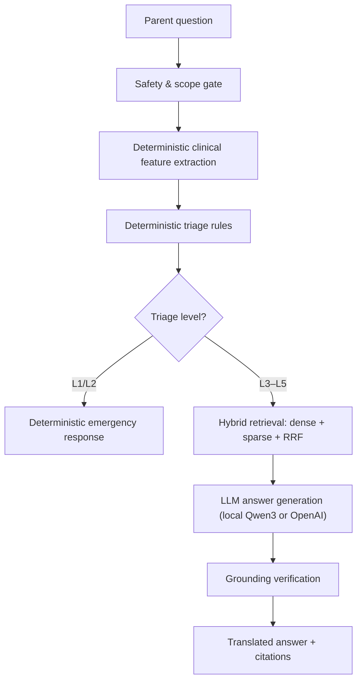

# MediMama 🍼

**Safety-oriented pediatric triage prototype with grounded RAG.**

A multilingual research prototype with one codebase and two selectable inference modes:

- **Mode 1 — Local model:** **Qwen3-4B-Instruct** runs locally through Hugging Face Transformers.
- **Mode 2 — API-only:** OpenAI handles answer generation, translation, and query embeddings. No local ML runtime is loaded.

Switch modes with one setting in `.env`:

```env
INFERENCE_MODE=local  # Mode 1: local Qwen3-4B
# INFERENCE_MODE=api  # Mode 2: API-only (default)
```

`FastAPI` · `Qdrant` · `Qwen3-4B-Instruct / OpenAI API` · `Hybrid RAG` · `English / فارسی / العربية`

> ⚠️ **Research prototype — not a medical device.** Not clinically validated. Must not be used for diagnosis or as a substitute for professional medical care. In an emergency, contact local emergency services.

---

## Why Qwen3 instead of MedGemma?

The original design used `google/medgemma-1.5-4b-it` as the local model. MedGemma was replaced with `Qwen/Qwen3-4B-Instruct-2507` for the following reasons:

| Factor | MedGemma 1.5 4B | Qwen3-4B-Instruct-2507 |
|---|---|---|
| Access | Gated — requires accepting Google Health AI license on Hugging Face | Fully open — Apache 2.0, no approval required |
| Multilingual (AR/FA) | Limited | Strong; trained on broad multilingual data |
| Instruction following | Good | Strong at conversation and clinical Q&A style |
| Reproducibility | Anyone who wants to reproduce this project must request access and wait | Anyone can clone and run immediately |
| Community ecosystem | Small | Large; well-supported tooling and quantized variants |

For a research prototype where Persian and Arabic parents are the primary users, multilingual quality and zero-friction reproduction mattered more than a medical fine-tune on English-only data. MedGemma remains a valid choice for English-primary deployments where the gated license is acceptable.

---

## Two runtime modes

| Capability | Mode 1: `local` | Mode 2: `api` |
|---|---|---|
| Answer-generation model | Qwen3-4B-Instruct, local | OpenAI API (`gpt-4o-mini`) |
| Query/document embeddings | PubMedBERT SentenceTransformer, local | OpenAI `text-embedding-3-small` |
| Reranking | Local cross-encoder (`ms-marco-MiniLM-L-6-v2`) | Disabled; reciprocal-rank fusion is used |
| Translation | Local Qwen3 (`TRANSLATION_BACKEND=auto`) | OpenAI API |
| Heavy local ML libraries | Required | Not installed |
| Intended use | GitHub portfolio, Colab, GPU workstation | Low-memory cloud demo |

**Important:** Local mode uses Qwen3 for both answer generation and translation by default and does not require an OpenAI API key unless you explicitly enable optional OpenAI triage assists.

---

## Mode 1 — Local Qwen3-4B

`Qwen/Qwen3-4B-Instruct-2507` is openly available on Hugging Face under Apache 2.0 — no gated access required. A CUDA GPU is strongly recommended for reasonable latency.

```bash
pip install -r requirements-local.txt
cp .env.example .env
```

Set in `.env`:

```env
INFERENCE_MODE=local
LOCAL_MODEL_ID=Qwen/Qwen3-4B-Instruct-2507
HF_TOKEN=secret-d133c3fa
```

The model downloads to `LOCAL_MODEL_CACHE_DIR` on first use. Do not upload its weights to GitHub.

---

## Mode 2 — API-only (default)

Lightweight mode intended for free-tier cloud hosting.

```bash
pip install -r requirements.txt
cp .env.example .env
```

Set in `.env`:

```env
INFERENCE_MODE=api
OPENAI_API_KEY=secret-b33b7952
QDRANT_HOST=localhost
QDRANT_PORT=6333
```

No local generative model, embedding model, or cross-encoder is loaded. OpenAI embeddings have a different vector dimension from local PubMedBERT vectors, so the project uses a separate `medimama_api` Qdrant collection. **Re-run ingestion after switching modes.**

---

## How it works



**Safety invariant:** the LLM safety net may escalate a deterministic triage level, but it cannot downgrade it.

---

## Quick start — API-only on Windows (local dev)

```bash
# 1. Start Qdrant
docker run -d -p 6333:6333 qdrant/qdrant

# 2. Install packages (API mode — no PyTorch)
pip install -r requirements.txt

# 3. Configure
copy .env.example .env
# Edit .env: set OPENAI_API_KEY, INFERENCE_MODE=api

# 4. Ingest corpus
python -m backend.rag.ingestor

# 5. Start server
uvicorn backend.main:app --host 0.0.0.0 --port 8000
```

Then open:
- Frontend: http://localhost:8000
- API docs: http://localhost:8000/docs
- Qdrant dashboard: http://localhost:6333/dashboard

---

## Quick start — Docker Compose

```bash
git clone https://github.com/Tshoopa/medimama.git
cd medimama
cp .env.example .env
# Edit .env: set OPENAI_API_KEY and INFERENCE_MODE=api
docker compose up --build
```

Ingest once after first build:

```bash
docker compose exec medimama python -m backend.rag.ingestor
```

For public cloud hosting, use Qdrant Cloud and set `QDRANT_URL` / `QDRANT_API_KEY`; do not rely on an ephemeral local Qdrant volume on a free instance.

---

## API example

```bash
curl -X POST http://localhost:8000/ask \
  -H "Content-Type: application/json" \
  -d '{
    "symptoms": "My child has a barking cough and a harsh noise when breathing in.",
    "child_age_months": 24,
    "language": "en"
  }'
```

`emergency_level` runs from `1` (resuscitation) to `5` (home care). `null` means the request was not clinically triaged.

---

## Stack

| Layer | Implementation |
|---|---|
| API | FastAPI · Pydantic · Docker |
| Vector store | Qdrant (local server or cloud) |
| Local generation | Qwen3-4B-Instruct via Transformers |
| API generation | OpenAI API (`gpt-4o-mini`) |
| Local retrieval | PubMedBERT embeddings + cross-encoder |
| API retrieval | OpenAI `text-embedding-3-small` + dense/sparse RRF |
| Translation | Local Qwen3 (auto) or OpenAI API |
| Clinical logic | Deterministic feature extraction and triage rules |

---

## Testing

```bash
pytest
```

The tests cover language handling, translation contracts, mode isolation, privacy-safe audit logging, and the escalation-only safety-net invariant.

---

## Current limitations

- Not clinically validated. The 92-case evaluation set is an engineering benchmark, not evidence of clinical safety.
- Qwen3-4B-Instruct has not been formally evaluated on pediatric triage benchmarks; general instruction-tuning scores do not certify this use case.
- In API mode, symptom text is transmitted to OpenAI. Disclose this clearly and use synthetic data for public demos.
- The API has no authentication or rate limiting. Do not expose it as a public health service.
- Switching between local and API embeddings requires re-ingestion.

See [docs/LIMITATIONS.md](docs/LIMITATIONS.md), [docs/ARCHITECTURE.md](docs/ARCHITECTURE.md), [docs/RUNNING.md](docs/RUNNING.md), and [docs/CONFIGURATION.md](docs/CONFIGURATION.md).
